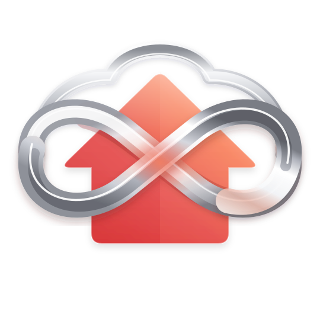
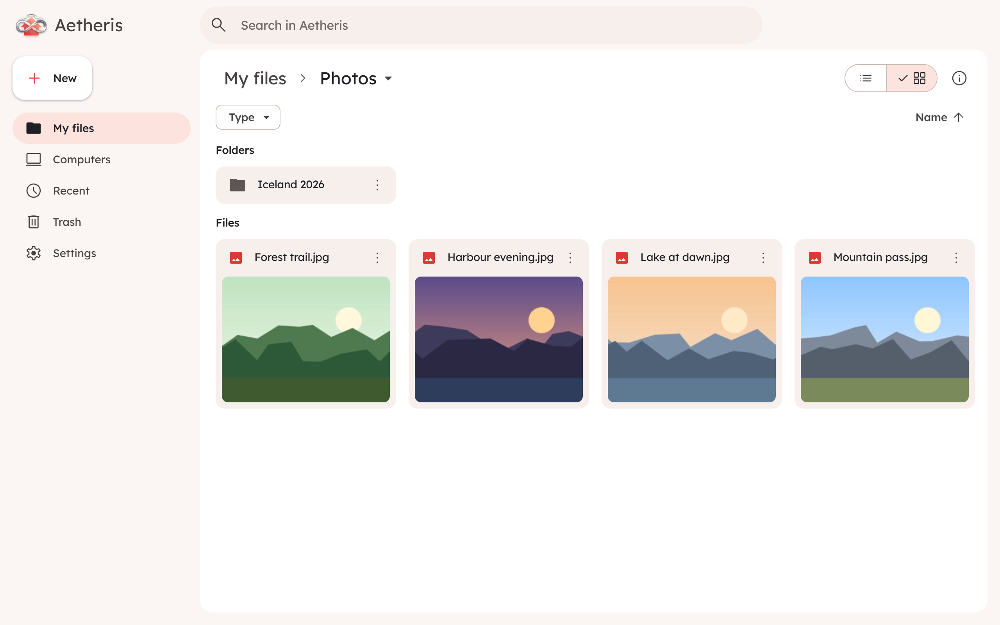
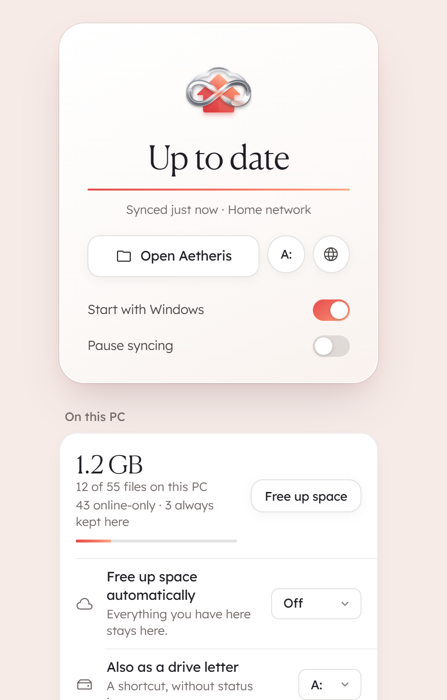
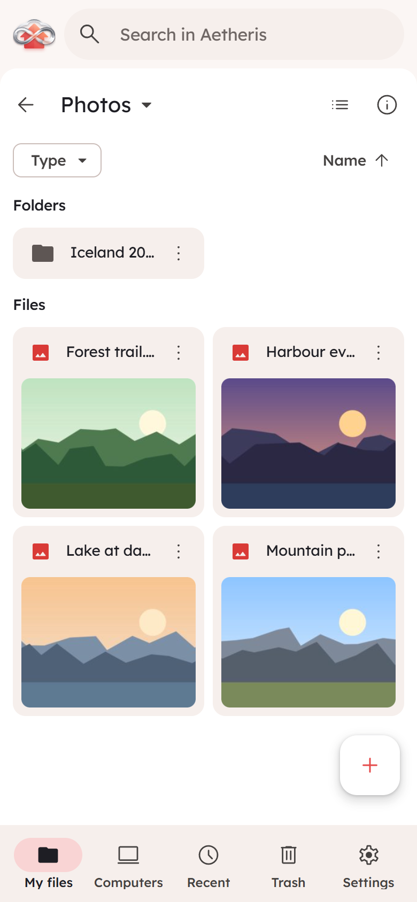
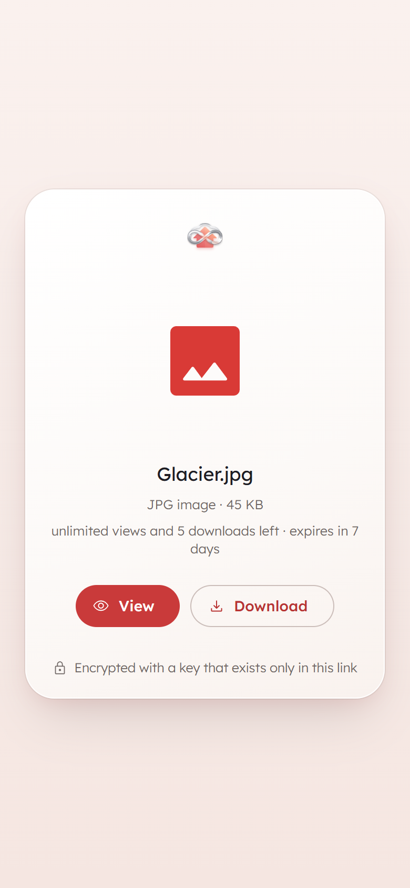

<p align="center">
  
</p>

<h1 align="center">Aetheris</h1>

<p align="center">Your own cloud drive, on a NAS at home.</p>

Aetheris works like Google Drive or OneDrive, but your files live on your own NAS as plain files, in an ordinary
shared folder. A Windows app puts them in Explorer, files download only when you open them, and folders from your PC
(Desktop, Documents and the like) sync to the NAS as well. A web app reaches everything from any browser.
Nothing at home is opened to the internet.



<p align="center">
  
  
  
</p>

## What you get

- **An Aetheris folder in Explorer.** Everything on the NAS shows up with cloud and check-mark status icons. A file
  downloads when you open it. *Always keep on this device* and *Free up space* work as they do in OneDrive, and
  Aetheris can free up files you haven't opened in a while by itself.
- **Folders from your PC.** Pick Desktop, Documents, Pictures or any other folder. It syncs both ways with the NAS.
  On the web these folders appear under **Computers**, by PC name, with their own icons.
- **A web app** for any browser and your phone: browse, search, sort, upload files and whole folders, preview photos,
  video, audio, PDFs and text, restore earlier versions, and get things back from the trash.
- **Share links** that open one file without an account, encrypted with a key that exists only in the link. They can
  expire, or allow only a set number of views and downloads.
- **Passkeys instead of passwords**, and a separate sign-in for each PC that you can revoke from Settings.
- **Automatic updates** for the Windows app.

## Get started

**Someone already runs an Aetheris server for you?** Download **AetherisSetup.exe** from the
[latest release](https://github.com/realCmdData/aetheris/releases/latest), run it, and pair it from the web app's
**Settings › Pair a device**. The [Windows app guide](docs/windows-app.md) has the details.

**Setting up your own?** You need a Linux machine at home (a NAS will do), a Tailscale account, a Vercel account and a
domain. [Run your own Aetheris](docs/self-hosting.md) takes you through it in six steps.

## Documentation

| Page | What's in it |
|---|---|
| [**The Windows app**](docs/windows-app.md) | Installing, the Aetheris folder, folders from your PC, freeing up space, conflicts, updates, the command line, uninstalling |
| [**The web app**](docs/web-app.md) | Finding your way, sorting, Quick Look, uploading, keyboard shortcuts, versions, the trash, share links, settings, your phone |
| [**Run your own Aetheris**](docs/self-hosting.md) | What you need, how the pieces fit, and the steps: |
| &emsp;[1. Tailscale](docs/self-hosting/01-tailscale.md) | MagicDNS and HTTPS, tags, the access policy, a key for the gateway |
| &emsp;[2. The server](docs/self-hosting/02-server.md) | Building, folders, first start, starting on boot (systemd, NAS), the home network, commands and flags |
| &emsp;[3. The web app and gateway](docs/self-hosting/03-web-gateway.md) | The Vercel project, environment variables, your domain, a rate limit |
| &emsp;[4. Your first passkey](docs/self-hosting/04-first-sign-in.md) | The setup link, a second passkey, getting back in |
| &emsp;[5. Your PCs](docs/self-hosting/05-windows-pcs.md) | Pairing, PCs with and without Tailscale, removing a PC |
| &emsp;[6. Looking after it](docs/self-hosting/06-maintenance.md) | Updating, backups, moving, health checks |
| [**Security**](docs/security.md) | What can reach what, signing in, share-link encryption, and the limits |
| [**Troubleshooting**](docs/troubleshooting.md) | Logs, and the usual problems with the server, the web app and the Windows app |
| [**Development**](docs/development.md) | The repository, running it locally, tests, building, releases |
| [**Protocol**](docs/protocol.md) | The API shared by the server, the gateway, the web app and the Windows app |

## How it fits together

```
 Browser ──HTTPS──▶ web gateway (Vercel) ──WireGuard (Tailscale)──┐
                                                                  ▼
 Windows app ──home network, or WireGuard (Tailscale)──────▶  NAS: one aetheris process
                                                                ├─ plain files in a normal shared folder
                                                                └─ an index, earlier versions, the trash
```

- **No open ports at home.** The NAS only makes outgoing connections, and only the Aetheris process joins the tailnet,
  never the NAS's own admin system.
- **The Windows app never goes through the web gateway.** It talks to the NAS directly, at home or over Tailscale.
- **Your files stay readable without Aetheris.** They are ordinary files in an ordinary shared folder. Aetheris adds
  an index, earlier versions (the last 10 of each file, or 30 days, whichever keeps more) and a trash (30 days)
  next to them.
- **Aetheris is not a backup.** Versions and the trash help with mistakes, not with a failed disk or a lost NAS.
  Keep a separate backup of the NAS.

More in [Security](docs/security.md).

## License

No license has been chosen yet, so the usual copyright rules apply: all rights reserved.
