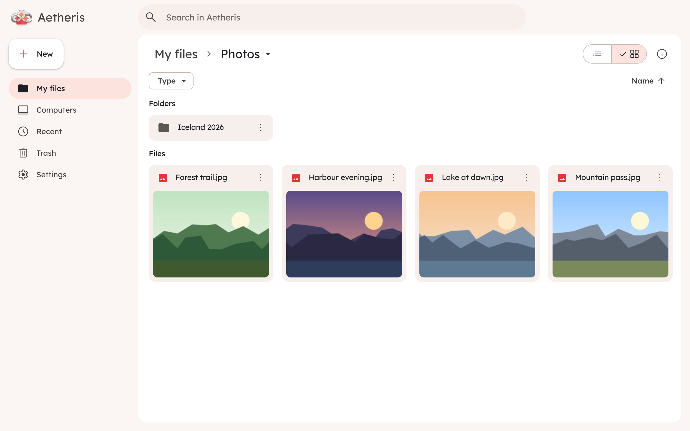

# Run your own Aetheris

[← Documentation](../README.md#documentation)

This guide sets up a complete Aetheris of your own: the server at home, the web app on your own domain, and your
Windows PCs. Plan on an hour or so, most of it waiting for DNS. Nothing in the code is tied to one installation: the
web address lives with the server's private state, and the Windows app learns everything else when you pair it.



## What you need

| | What | Why |
|---|---|---|
| **A machine at home** | Linux on x86-64, always on: a NAS, a mini PC, a home server. 1 GB of RAM is plenty. | Runs the server, one static binary (no Docker, no runtime). It holds your files. |
| **Tailscale** | A free [Tailscale](https://tailscale.com) account | Connects the server, the web gateway and your PCs without opening a port at home |
| **Vercel** | A free [Vercel](https://vercel.com) account | Hosts the web app and the gateway that forwards it to your server |
| **A domain** | Any domain or subdomain you control, for example `drive.example.com` | The web app's address. Passkeys belong to it, so pick one you'll keep. |
| **A PC to build on** | [Go](https://go.dev/dl/) 1.27 or later, and Git | Builds the server. Node.js is only needed if you change the web app. |

You don't need a static IP address, port forwarding, a reverse proxy or your own TLS certificates.

## How the pieces fit

```
 Browser ──HTTPS──▶ web gateway (Vercel) ──WireGuard (Tailscale)──┐
                                                                  ▼
 Windows app ──home network, or WireGuard (Tailscale)──────▶  your server: one aetheris process
                                                                ├─ your files, as plain files
                                                                └─ .aetheris/: index, versions, trash
```

- **The server** joins your tailnet by itself (it has Tailscale built in), so only the Aetheris process is reachable
  over the tailnet, never the rest of the machine. It also listens on your home network (port 8443) for PCs at home.
- **The web gateway** is a small Go program on Vercel. It serves the web app and forwards API requests over the
  tailnet, but only sign-in requests and requests carrying a valid session. Everything else stops at Vercel.
- **The Windows app** talks to the server directly: on your home network when it can, over Tailscale when it can't.
  It never goes through Vercel.

## The steps

| Step | What you do | Takes |
|---|---|---|
| [1. Tailscale](self-hosting/01-tailscale.md) | Turn on MagicDNS and HTTPS, add two tags and an access policy, create a key for the gateway | 10 min |
| [2. The server](self-hosting/02-server.md) | Build it, copy it to your machine, tell it your web address, start it on boot | 15 min |
| [3. The web app and gateway](self-hosting/03-web-gateway.md) | Deploy `gateway/` to Vercel, set three environment variables, add your domain | 15 min |
| [4. Your first passkey](self-hosting/04-first-sign-in.md) | Open a one-time setup link and create a passkey | 2 min |
| [5. Your PCs](self-hosting/05-windows-pcs.md) | Install the Windows app and pair it | 5 min per PC |
| [6. Looking after it](self-hosting/06-maintenance.md) | Updates, backups, moving, starting over | when needed |

Throughout the guide, these example values stand for yours:

| Example | Stands for |
|---|---|
| `drive.example.com` | your web address |
| `tail1234.ts.net` | your tailnet's DNS name (Tailscale shows it under **DNS**) |
| `aetheris.tail1234.ts.net` | your server's name on the tailnet |
| `192.168.1.20` | your server's address on your home network |
| `/srv/aetheris/files` | the folder with your files |
| `/var/lib/aetheris` | the server's private state |

## When you're done

- `https://drive.example.com` shows your files after a passkey sign-in, from any browser.
- Each PC has an **Aetheris** folder in Explorer with everything on the server, downloaded when opened, and syncs the
  folders you choose from it.
- Nothing at home accepts connections from the internet. Check with any port scanner: there's nothing to find.

Something not working? See [Troubleshooting](troubleshooting.md).
