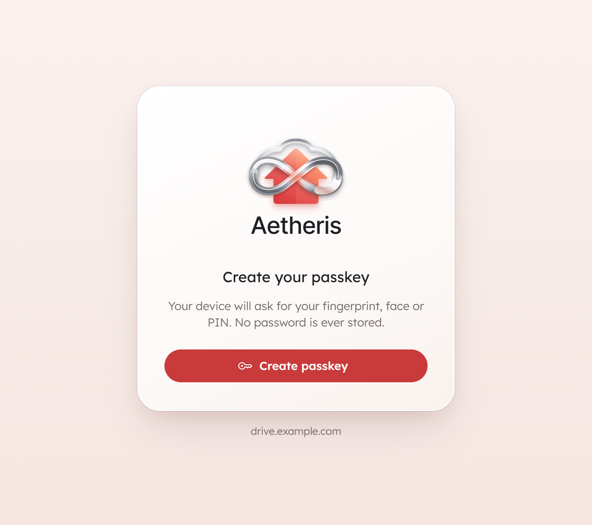

# 4. Your first passkey

[← 3. The web app and gateway](03-web-gateway.md) · [Run your own Aetheris](../self-hosting.md) · Next: [5. Your PCs →](05-windows-pcs.md)

Aetheris has no passwords. You sign in with a **passkey**: your device unlocks it with your fingerprint, face or PIN
(Windows Hello, Touch ID, Face ID, Android's screen lock, or a security key). The first one is created with a
one-time link from the server.

## Create it

On the server:

```console
$ sudo -u aetheris /opt/aetheris/aetheris setup -state /var/lib/aetheris
Open this link within 15 minutes to register your first passkey:

  https://drive.example.com/#setup=k3Jd9QeXr7…
```

Open the link on the device that should hold the passkey, choose **Create passkey** and confirm with your fingerprint,
face or PIN. That's it: you're signed in and see your files.



The part after `#` never leaves your browser, so neither Vercel nor anyone watching the network sees it. The link
works once and only for 15 minutes; run `setup` again for a new one.

## Add a second one

Open **Settings** and choose **Add a passkey** under **Passkeys**. Keep at least two, for example your phone and your
PC, so losing one device never locks you out. Each passkey shows when it was last used, and you can remove it there.

To sign in on a computer that has none of your passkeys, choose **Sign in with passkey** and pick your phone in the
browser's dialog: it shows a QR code that your phone scans to sign you in.

## Locked out?

If you've lost every passkey, run `reset` on the server. It removes all passkeys, signs out every browser and every
PC, and prints a new setup link:

```bash
sudo -u aetheris /opt/aetheris/aetheris reset -state /var/lib/aetheris
```

Your files aren't touched. PCs need pairing again afterwards.

Next: [5. Your PCs →](05-windows-pcs.md)
