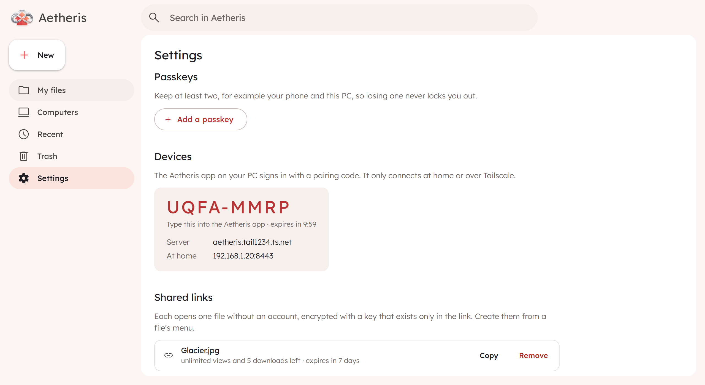
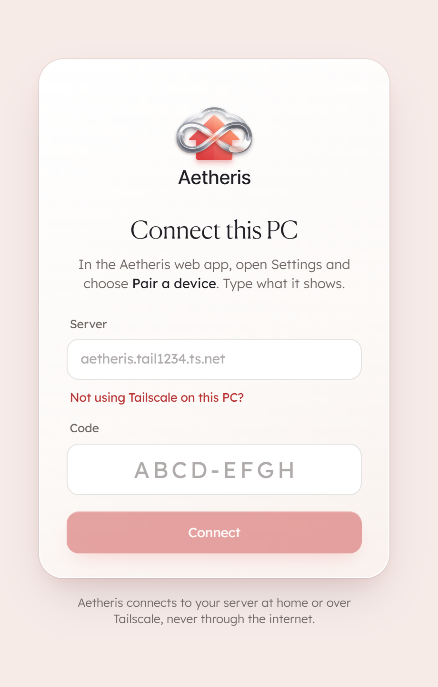
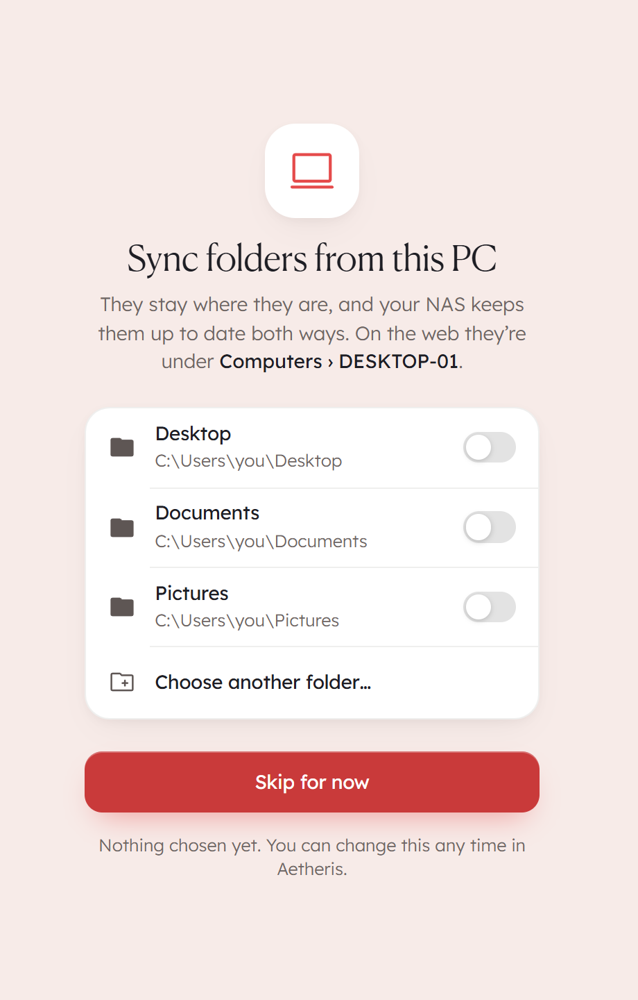
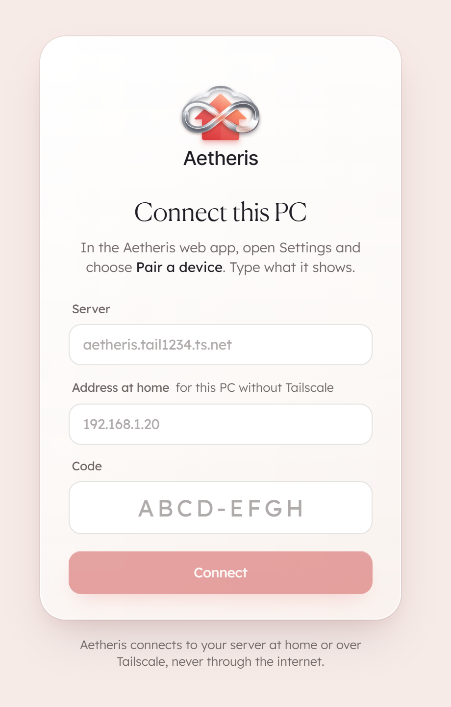

# 5. Your PCs

[← 4. Your first passkey](04-first-sign-in.md) · [Run your own Aetheris](../self-hosting.md) · Next: [6. Looking after it →](06-maintenance.md)

Each PC gets the Windows app and its own sign-in, which you can revoke on its own. The app finds your server by
itself after pairing: there's nothing to configure.

## Install

Download **AetherisSetup.exe** from the [latest release](https://github.com/realCmdData/aetheris/releases/latest)
and run it. The [Windows app guide](../windows-app.md#install) has the details (SmartScreen, WebView2, scripted
installs).

## Pair

1. In the web app, open **Settings** and choose **Pair a device**. It shows a code, valid for 10 minutes, with your
   server's name and its address at home:

   

2. In the Aetheris app on the PC, type the **Server** and the **Code**, and choose **Connect**:

   

3. Choose the folders this PC should sync, or **Skip for now**:

   

The **Aetheris** folder appears in Explorer, and the PC appears in **Settings › Devices** under its Windows name.

## PCs with and without Tailscale

The app always tries your home network first and the tailnet second. It never goes through Vercel.

| The PC has… | At home | Away |
|---|---|---|
| **Tailscale**, signed in to your tailnet | Connects directly to the server's home address (port 8443) | Connects over the tailnet |
| **No Tailscale** | Connects directly to the server's home address | Waits until it's home again, then catches up |

For a PC without Tailscale, choose **Not using Tailscale on this PC?** while pairing and type the **address at home**
that Settings shows. An address without a port means port 8443; a name instead of an address works too.



Either way, the connection is checked against your server's real Tailscale certificate, so a different machine at that
address at home can't pretend to be your server.

## From a terminal

The app can also pair from PowerShell or a script, with the server and the code from **Pair a device**:

```powershell
& "$env:LOCALAPPDATA\Programs\Aetheris\Aetheris.exe" pair aetheris.tail1234.ts.net K7PD-4QXM
```

See [the Windows app's command line](../windows-app.md#command-line) for the rest.

## Remove a PC

In **Settings › Devices**, choose **Remove** next to it. Its sign-in stops working at once: the next time the PC
reaches the server, the app says it was signed out and asks to be paired again. Nothing is deleted. Files it had
downloaded stay on the PC, and online-only files open again once it's paired. To take Aetheris off the PC entirely,
[uninstall](../windows-app.md#uninstall) it.

Next: [6. Looking after it →](06-maintenance.md)
