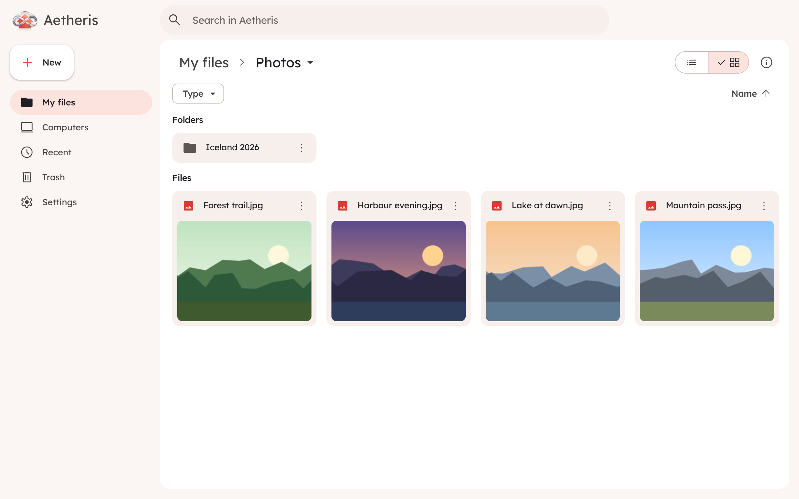
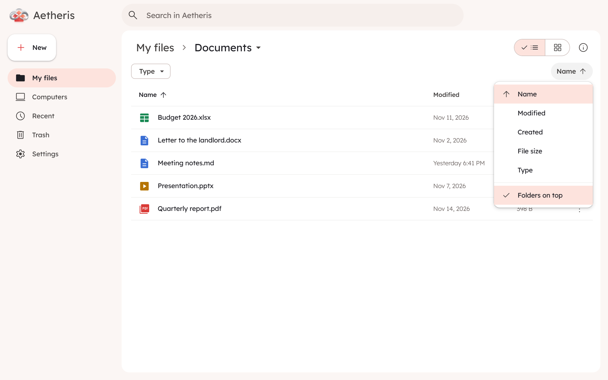
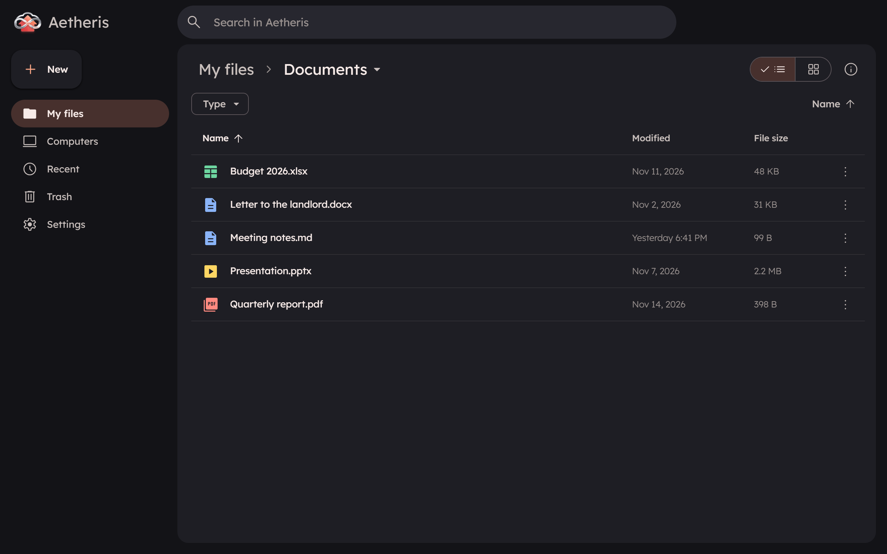
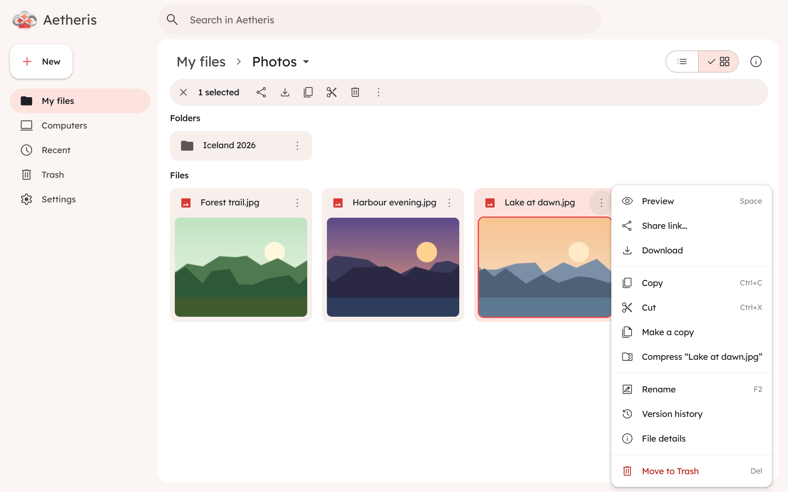
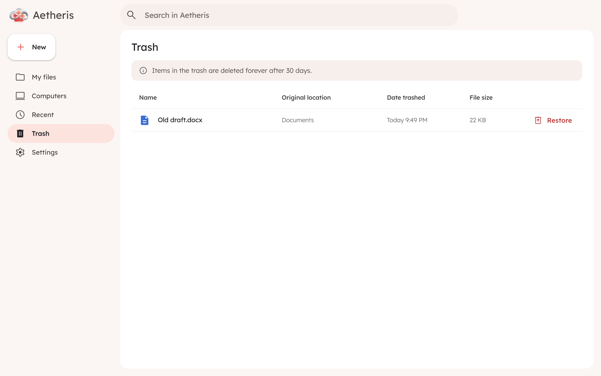
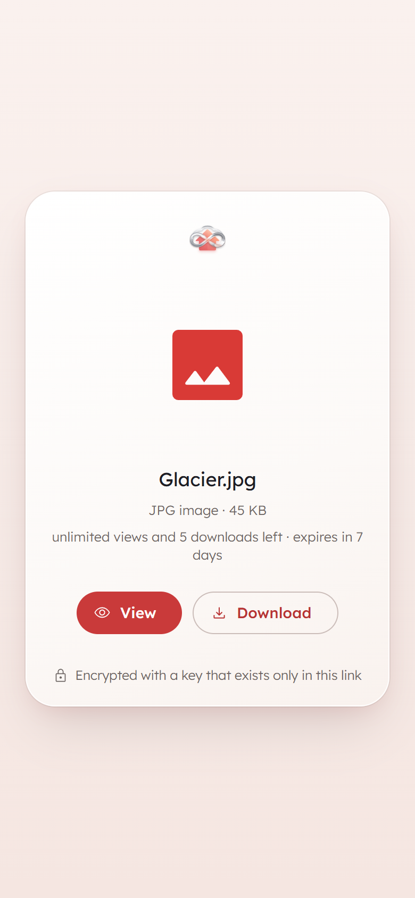
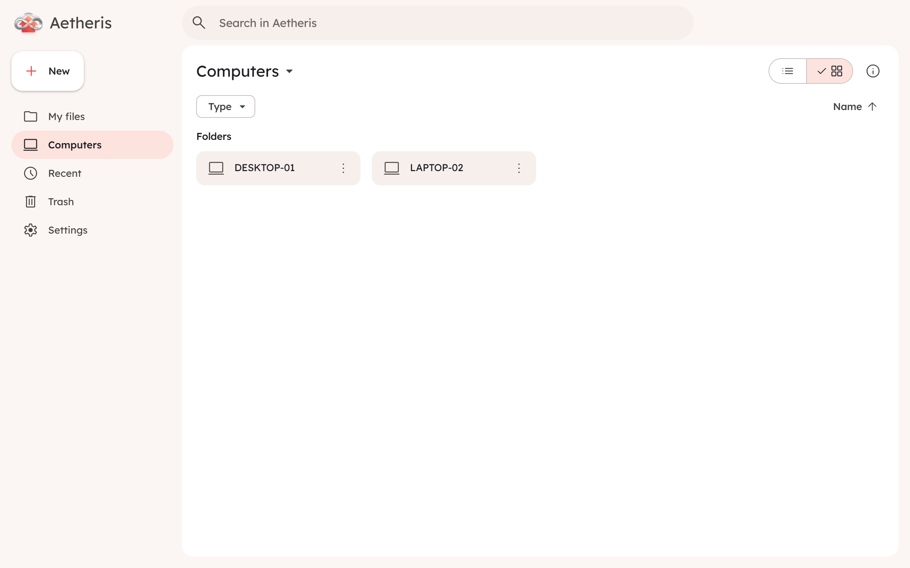
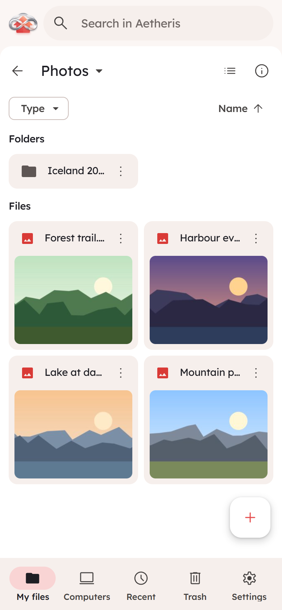

# The web app

[← Documentation](../README.md#documentation)

The web app reaches everything on your server from any browser, your phone included. Sign in with a passkey: there
are no passwords.

## Finding your way

| Section | Shows |
|---|---|
| **My files** | Everything on your server, apart from your PCs' folders |
| **Computers** | Folders that your PCs sync, by PC name ([Windows app](windows-app.md#folders-from-this-pc)) |
| **Recent** | Files you uploaded or changed lately, on any device |
| **Trash** | Deleted files and folders, for 30 days |
| **Settings** | Passkeys, paired PCs, share links, browsers, activity |

**Search** (the box at the top, or press <kbd>/</kbd>) finds files and folders anywhere whose path contains what you
type, ignoring case.

### Views and sorting

Switch between **grid** and **list** at the top right. Photos get thumbnails in the grid; the list shows when each
item changed and its size. Folders have sizes too: everything inside them.

The sort button (**Name ↑**) sorts by **Name**, **Modified**, **Created**, **File size** or **Type**.
**Folders on top** keeps folders first in the list. The **Type** chip shows only photos, videos, audio, documents or
text. Your choices are remembered in each browser.

The ⓘ button opens the details panel for the selected item, with its size and when it was created and last changed.

The web app follows your system's light or dark mode:

## Quick Look

Double-click a file, or select it and press <kbd>Space</kbd>, to preview it: photos, video, audio, PDFs and text.
<kbd>←</kbd> and <kbd>→</kbd> step through the folder; <kbd>Esc</kbd> closes it.

## Adding files

- **Drag and drop** files or whole folders onto the page.
- Or choose **New**: **New folder**, **File upload** or **Folder upload**.

Uploads show their progress while they run and reach your PCs as soon as they finish.

## Working with files

Right-click an item (or use its ⋮ button) for its menu. Select several with <kbd>Ctrl</kbd>/<kbd>⌘</kbd>-click or
<kbd>Shift</kbd>-click, or with <kbd>Shift</kbd> and the arrow keys.

| Action | Notes |
|---|---|
| **Preview** / **Open** | Quick Look for files, into the folder for folders |
| **Share link…** | See [Share links](#share-links) |
| **Download** / **Download as zip** | Folders and multiple items download as one zip |
| **Copy**, **Cut**, then **Paste** | Copy or move, also between folders and into a PC's folder |
| **Make a copy** | A copy next to the original |
| **Compress** | Makes a zip on the server, next to the items |
| **Rename** | <kbd>F2</kbd> |
| **Version history** | Earlier versions: download one or restore it |
| **File details** | The details panel |
| **Move to Trash** | <kbd>Delete</kbd>; restorable for 30 days |

### Keyboard shortcuts

| Keys | Does |
|---|---|
| <kbd>↑</kbd> <kbd>↓</kbd> <kbd>←</kbd> <kbd>→</kbd> | Move the selection (<kbd>Shift</kbd> extends it) |
| <kbd>Enter</kbd> | Open |
| <kbd>Space</kbd> | Quick Look |
| <kbd>Backspace</kbd> | Up one folder |
| <kbd>F2</kbd> | Rename |
| <kbd>Delete</kbd> or <kbd>⌘</kbd>+<kbd>Backspace</kbd> | Move to Trash |
| <kbd>Ctrl</kbd>/<kbd>⌘</kbd>+<kbd>A</kbd> | Select all |
| <kbd>Ctrl</kbd>/<kbd>⌘</kbd>+<kbd>C</kbd>, <kbd>X</kbd>, <kbd>V</kbd> | Copy, cut, paste |
| <kbd>/</kbd> | Search |
| <kbd>Esc</kbd> | Clear the selection, close a menu or Quick Look |

## Versions and the trash

Every time a file changes, the server keeps the version before: the last 10 of each file, or everything from the last
30 days, whichever keeps more. **Version history** lists them; **Restore** brings one back (the current one becomes a
version in turn).

Deleted files and folders, from the web or any PC, go to the **Trash** for 30 days. **Restore** puts them back where
they were, and they reappear on your PCs.

## Share links

**Share link…** makes a link that opens one file without an account. Choose how often it may be **viewed** (in the
browser) and **downloaded**: **None**, **Once**, **5 times** or **No limit**, and when it **expires**: after 1 hour,
1 day, 7 days or 30 days. Copy the link, or type email addresses to hand it to your email app.

The file is encrypted with a key that exists only in the link, after the `#`, which browsers never send anywhere. The
gateway and anything between it and the recipient only ever see encrypted bytes. The recipient sees this:

**Settings › Shared links** lists the links that still work, with what's left of each; **Remove** ends one at once.

## Computers

**Computers** lists each PC that syncs folders, and inside each PC its folders, with the icon they have on that PC.
You can work in them like anywhere else, and changes reach the PC. Deleting one of a PC's folders here makes that PC
stop syncing it; the files on the PC stay.

## Settings

| Section | What you can do |
|---|---|
| **Passkeys** | Add one (keep at least two), see when each was last used, remove one |
| **Devices** | **Pair a device** for a new PC; see when each PC was last seen; **Remove** one |
| **Shared links** | Copy or remove links that still work |
| **Browsers** | See where you're signed in; sign out another browser, or this one |
| **Activity** | Sign-ins and refused ones, pairings, passkey changes, deletes and restores, share link views and downloads |

## On your phone

The web app works the same on a phone, with the sections at the bottom. In Safari, choose **Share › Add to Home
Screen**, or in Chrome **⋮ › Add to Home screen**, to give it its own icon.

