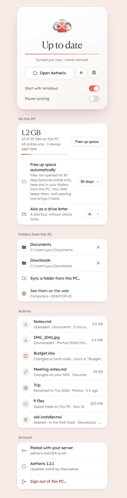
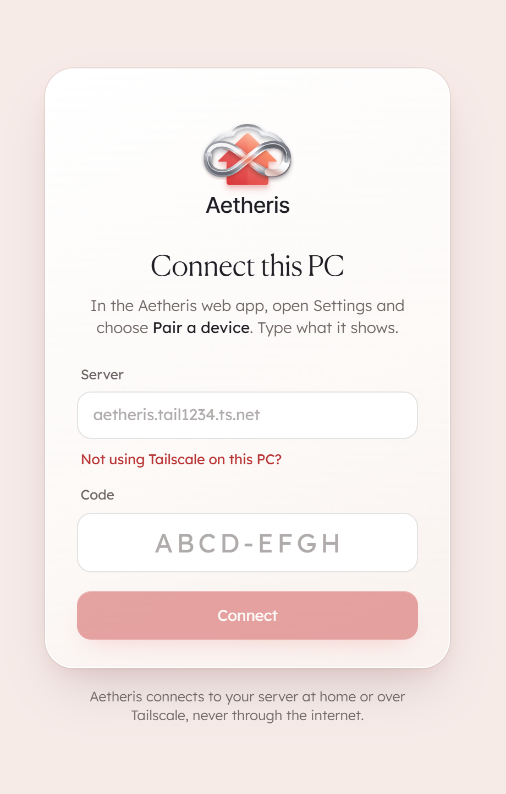
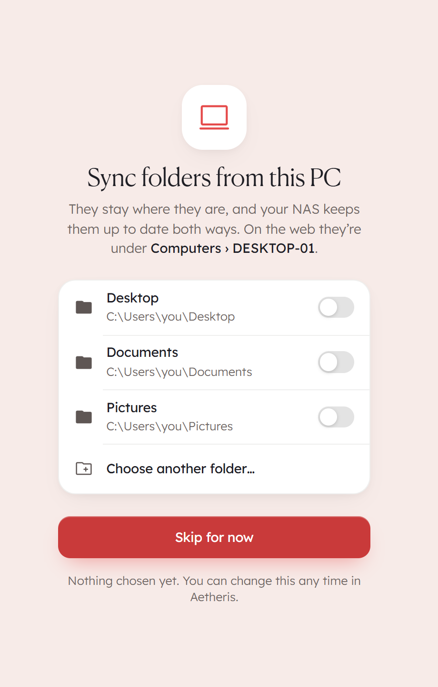
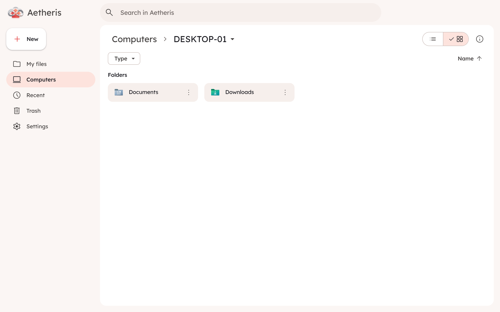
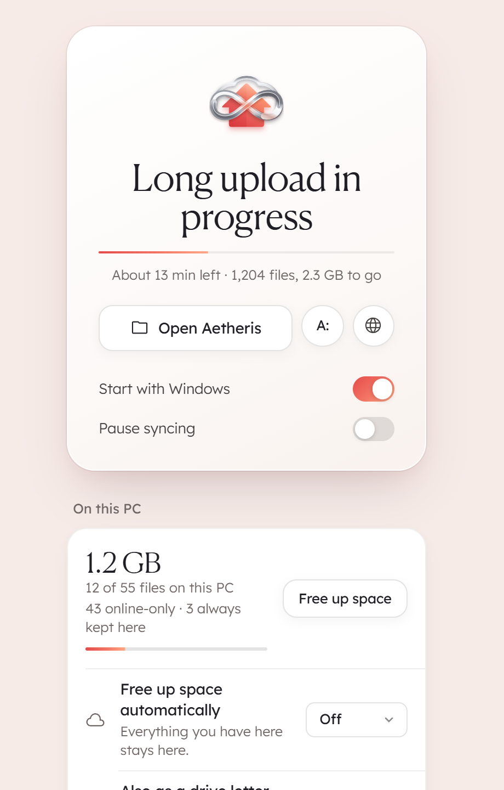

# The Windows app

[← Documentation](../README.md#documentation)

The Windows app puts everything on your server into an **Aetheris** folder in Explorer, downloading files only when
you open them, and keeps folders from your PC (Desktop, Documents and the like) in sync with the server.



## Install

You need Windows 10 (version 2004 or later) or Windows 11, 64-bit, and an Aetheris server: yours, or one you
[run yourself](self-hosting.md). The app's window uses Microsoft Edge WebView2, which Windows 11 includes; on Windows
10 it may need [installing from Microsoft](https://developer.microsoft.com/microsoft-edge/webview2/) first.

1. Download **AetherisSetup.exe** from the [latest release](https://github.com/realCmdData/aetheris/releases/latest).
2. Run it. The app isn't code-signed yet, so Windows may say it protected your PC: choose **More info**, then
   **Run anyway**.
3. In **Aetheris Setup**, choose **Install**. Tick *Add a shortcut to the desktop* if you like.

Aetheris installs for your Windows user only, without admin rights, into `%LOCALAPPDATA%\Programs\Aetheris`. It
appears in the Start menu and in **Settings › Apps › Installed apps**. Every Windows user on a PC installs and pairs
their own copy.

Running a newer AetherisSetup.exe later updates it the same way (the dialog then says **Update**). To install without
the dialog, from a script or a deployment tool:

```powershell
.\AetherisSetup.exe --quiet
```

## First-time setup

The app opens on two steps: connect this PC to your server, then choose folders to sync. [Your PCs](self-hosting/05-windows-pcs.md)
in the self-hosting guide walks through both, with and without Tailscale.

<p>
  
  
</p>

Afterwards the app lives in the notification area. Click its icon to open the window; right-click for a menu with
the status, **Open Aetheris folder**, your web address, **Pause syncing**, **Start with Windows** and **Quit**.

## The Aetheris folder

It's at `%USERPROFILE%\Aetheris` and shows everything on your server, with OneDrive's status icons:

| Icon | Means |
|---|---|
| Cloud | **Online-only.** Takes no space; downloads when you open it (this needs a connection to your server). |
| Green check, outlined | **On this PC.** Downloaded; can be freed again. |
| Green check, filled | **Always kept on this PC.** You chose *Always keep on this device*. |
| Arrows | **Syncing.** |

Right-click any file or folder for **Always keep on this device** and **Free up space**. Edits, new files, renames and
deletes go to the server within seconds and from there to your other PCs and the web. Deleted items go to the
server's trash, where you can restore them for 30 days.

If Windows is in Developer Mode, Aetheris also gets its own entry in Explorer's navigation pane, like OneDrive.
Otherwise the folder is in your user folder (pin it to **Quick access** if you like).

**Also as a drive letter** (in the window, off by default) maps the folder to a letter such as `A:`. It's a shortcut
only: Explorer shows no status icons there.

### When two PCs change the same file

If a file changed on the server while you were editing it, Aetheris keeps both: the original name gets the server's
version, and yours is saved next to it as `Budget (conflict DESKTOP-01 2026-11-06 17.05).xlsx`. Windows shows a
notification, and the window lists it under **Activity**.

## Folders from this PC

Pick Desktop, Documents, Pictures or any other folder, during setup or later under **Folders from this PC**. They
sync both ways with the server, and every file stays on your PC as it is.

- On the web they're under **Computers › your PC's name**, with the folder's own icon (Downloads keeps its arrow):

  

- A change on the web or on another device reaches the folder on your PC too.
- **Stop syncing** (the ✕ next to a folder) keeps the files on your PC and the copy on the server.
- Deleting a PC's folder under **Computers** on the web makes that PC stop syncing it. The files on the PC stay.
- Aetheris can't sync whole drives, Windows or app folders, network drives, drives that aren't NTFS, or folders that
  another app such as OneDrive already syncs.

Inside these folders, Aetheris leaves out what it can't sync safely:

- **Symbolic links and junctions** are skipped (their targets are not followed).
- **Files with more than one hard link**, which some build tools create, are skipped. Hard-linked copies would
  otherwise be uploaded as separate files and come back as conflicts. The log names the first one it skipped.

## Free up space

Under **On this PC**, the window shows how much the Aetheris folder takes on this PC. **Free up space** makes every
downloaded file online-only again, except the ones you chose to always keep.

**Free up space automatically** does it for files you haven't opened in a while: choose 7, 14, 30, 60 or 90 days.
A few minutes after Aetheris starts, and every six hours after that, files not opened for that long become
online-only, both in the Aetheris folder and in your folders from this PC. Your server keeps them, and opening one
brings it back, after which it stays. Files you chose to always keep, unsent changes and open files are never freed.

Windows records when a file was opened only if *last access* updates are on, which they are on most PCs. Where they
aren't, the window says so and Aetheris goes by when files last changed instead.

## Long uploads

When you add a big folder, the window and the tray say **Long upload in progress**, with an estimate of the time
left, the number of files and how much is left to send, instead of flickering between files.



## Pause

**Pause syncing** stops syncing both ways until you resume. What you do yourself still reaches the server: opening an
online-only file downloads it, and deletes and renames in the folder go through.

## Updates

The app checks for a new release a minute after it starts and every six hours after that. It downloads it, checks it
against the SHA-256 that GitHub publishes with the release, and switches over once nothing is uploading or
downloading. Your version is shown at the bottom of the window and in **Settings › Apps › Installed apps**.

## Command line

The installed app is `%LOCALAPPDATA%\Programs\Aetheris\Aetheris.exe`. Besides running in the notification area, it
takes these commands:

| Command | Does |
|---|---|
| `Aetheris pair <server> <code>` | Pairs this PC, like the window does. The server can be left out when pairing again. |
| `Aetheris folders` | Lists the folders this PC syncs, and where each one is on the server. |
| `Aetheris add <path>` | Starts syncing a folder from this PC. |
| `Aetheris remove <path>` | Stops syncing it. The files stay on the PC and on the server. |
| `Aetheris --show` | Opens the window (the Start menu shortcut does this). |

For example, in PowerShell:

```console
PS> $aetheris = "$env:LOCALAPPDATA\Programs\Aetheris\Aetheris.exe"
PS> & $aetheris add "$env:USERPROFILE\Music"
PS> & $aetheris folders
C:\Users\you\Documents  →  Computers/DESKTOP-01/Documents
C:\Users\you\Music  →  Computers/DESKTOP-01/Music
```

## Where things are

| What | Where |
|---|---|
| The app | `%LOCALAPPDATA%\Programs\Aetheris` |
| The Aetheris folder | `%USERPROFILE%\Aetheris` |
| Settings and sign-in | `%LOCALAPPDATA%\Aetheris\nas`: the server's addresses (`server.txt`), the synced folders (`folders.txt`), and the sign-in (`token.bin`, encrypted for your Windows user) |
| The log | `%LOCALAPPDATA%\Aetheris\nas\aetheris.log` (the previous one is kept as `aetheris.log.old` once it passes 1 MB) |

## Uninstall

Go to **Settings › Apps › Installed apps**, open the menu next to **Aetheris** and choose **Uninstall**. Your files on
the server stay as they are. Files you had downloaded stay on the PC as normal files, files that were online-only
disappear from the PC, and the PC is signed out. Folders from this PC keep their files, except any that *Free up
space automatically* had made online-only: those are then only on the server.

Something not working? See [Troubleshooting](troubleshooting.md#the-windows-app).
